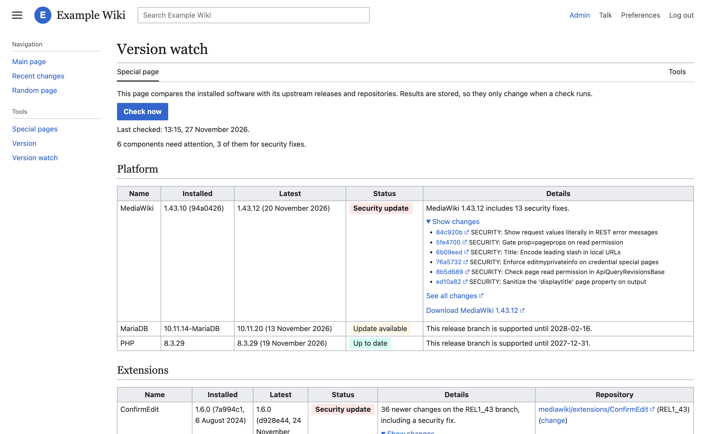
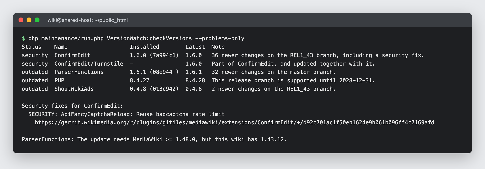

# VersionWatch

A MediaWiki extension that tells you when the software behind your wiki needs updating:
MediaWiki itself, PHP, the database server, and every installed extension and skin.

- Security fixes are recognised and put at the top.
- Each update lists the changes it brings, with a link to download it.
- It warns when an update needs a newer PHP or MediaWiki than you have.
- It checks whether your extensions and skins are ready for the newest MediaWiki release.
- With Echo installed, sysops get a notification when something new needs attention.

Results are shown on `Special:VersionWatch` (sysops only), printed by a maintenance script
that is meant to run from cron, and available through the API.





More screenshots are in [`docs/screenshots`](docs/screenshots). They come from
[an example page](docs/example/versionwatch-example.html) with sample data.

Requires MediaWiki 1.43 or later.

## Installation

1. Put this directory in `extensions/VersionWatch`.
2. Add to `LocalSettings.php`:
   ```php
   wfLoadExtension( 'VersionWatch' );
   ```
3. Schedule a daily check, for example in crontab or cPanel's Cron Jobs:
   ```
   15 4 * * * php /path/to/wiki/maintenance/run.php VersionWatch:checkVersions --problems-only
   ```
   With `--problems-only` the script prints nothing while everything is up to date. Cron
   mails any output, so you only get mail when something needs attention.

Sysops can also run a check at any time with the button on `Special:VersionWatch`.

## How components are checked

| Component | Compared against | Statuses |
|---|---|---|
| MediaWiki, PHP, MariaDB, MySQL, PostgreSQL, SQLite | Release data from [endoflife.date](https://endoflife.date) | *Update available* if a newer patch release exists on your branch; *Unsupported* once the branch reaches end of life |
| Extensions and skins installed from git, or downloaded from ExtensionDistributor | The matching release branch (`REL1_43` on 1.43) on Wikimedia Gerrit | *Update available* if the branch has commits you do not have |
| Extensions and skins that came with the MediaWiki download | The commit your MediaWiki release pinned them to, compared with the release branch like a git checkout | *Update available* if the branch has commits you do not have |
| Other extensions and skins without git information | The `version` in `extension.json` or `skin.json` on that branch | *Update available* if upstream has a higher version |

### Security updates

Wikimedia starts the commit message of every security fix with `SECURITY:`. When the newer
changes of an extension include one, or a newer MediaWiki release on your branch does, the
status is *Security update*, which is listed first. The details list the fixes.

### What an update contains

For extensions compared by commit, *Show changes* lists the changes that count, with links to
each one and to the full history. Outdated rows link to a download: ExtensionDistributor or
SkinDistributor on mediawiki.org for Wikimedia-hosted extensions and skins, a zip of the branch
for GitHub, and the download page for MediaWiki itself.

If the update needs a newer PHP or MediaWiki than the wiki has, according to the `requires` in
its `extension.json` or `skin.json`, that is shown too.

Modules that live inside another extension and are loaded as part of it, such as
`ConfirmEdit/Turnstile`, have no repository of their own. They get the status of the
extension they belong to.

Not every commit counts towards *Update available*:

- Commits from the translation bot, which land on every branch almost daily. See
  `$wgVersionWatchIgnoredAuthors`.
- For extensions on Wikimedia Gerrit, commits that only change development files: dot files
  such as `.phpcs.xml`, `package.json`, `package-lock.json`, `composer.json`, `Gruntfile.js`,
  `tests/` and the like. Wikimedia's library upgrade bot makes many of these, and they do not
  change how the extension behaves on a wiki. GitHub does not list files per commit, so there
  every commit counts.

Extensions bundled with the MediaWiki download have no git information, but each MediaWiki
release tag pins the exact commit of every bundled extension and skin. VersionWatch assumes
such an extension is the copy that came with your MediaWiki version, and checks that commit.
If you replaced a bundled extension with a newer copy that has no git information, install
it from git or ExtensionDistributor instead, so its own commit is used.

The report is kept in the main object stash, so viewing the special page never waits on
remote requests.

## Upgrading MediaWiki

When a newer MediaWiki release branch exists than the one you run, the report ends with whether
you can upgrade to it:

| Status | Meaning |
|---|---|
| *Ready* | The extension has a release branch for it, and its requirements are met |
| *Included* | It comes with that MediaWiki download |
| *Not available* | It has no release branch for it, so it is not maintained for that version |
| *Incompatible* | Its version for that release needs a newer PHP or MediaWiki |

It also says whether this server's PHP is supported by that release, and points out when the
newer release is supported for a shorter time than yours, as when moving from a long-term
support release.

## Notifications

With [Echo](https://www.mediawiki.org/wiki/Extension:Echo) installed, users with the
`versionwatch` right get a notification when a check finds something that newly needs
attention, or that became a security update. Something already reported is not reported again.
Notifications are on the web and by email by default; users can change that in their
preferences under *Software updates*. Without Echo, nothing changes.

## Where extensions are looked up

By default an extension or skin is looked up on Wikimedia Gerrit, on the release branch
matching your MediaWiki version. VersionWatch itself is the exception: it is looked up in its
GitHub repository. For anything else, such as an extension hosted on GitHub,
one that is only maintained on master, or local code without an upstream, use the *change*
link in the Repository column of `Special:VersionWatch`. The details column says when that
is needed.

Settings are saved as JSON on `MediaWiki:VersionWatch.json`, so every change appears in
recent changes and the page history, and can be reverted. Anyone who can edit that page can
change them; by default that is sysops and interface administrators. The page can also be
edited by hand:

```json
{
	"GTag": { "github": "owner/GTag" },
	"MaveVariables": false,
	"SomeExtension": { "branch": "master" }
}
```

Each entry is keyed by the name passed to `wfLoadExtension()` and is either `false` (do not
check) or an object with `gerrit` or `github` (the repository path) and/or `branch`. On GitHub
the default branch is used unless `branch` is set.

## Configuration

### `$wgVersionWatchGitHubToken`

Without a token, GitHub allows 60 API requests per hour per IP address, shared with
everyone else on that IP address, which can be a problem on shared hosting. Each GitHub-hosted
extension needs up to two requests per check. A
[fine-grained token](https://github.com/settings/personal-access-tokens) with no
permissions is enough.

### `$wgVersionWatchIgnoredAuthors`

Commit authors whose commits do not make an extension outdated. Defaults to
`[ 'Translation updater bot' ]`.

## Rights

`versionwatch` allows viewing `Special:VersionWatch`, running a check and reading the report
through the API. It is granted to `sysop` by default.

## API

`action=query&meta=versionwatch` returns the latest report. It does not run a check.

```
api.php?action=query&meta=versionwatch&vwprop=summary|components|upgrade&format=json
```

`summary` gives the number of components per status and how many need attention, which suits
monitoring tools. To use it from a script, create a
[bot password](https://www.mediawiki.org/wiki/Manual:Bot_passwords) with the *View the update
status of installed software* grant.

## Development

```
composer install
composer test        # lint, code style, executable bits
composer phan        # static analysis; needs MW_INSTALL_PATH pointing at core
```

Tests run from the core directory. The integration tests need an installed wiki:

```
php vendor/bin/phpunit extensions/VersionWatch/tests/phpunit
```

## Translating

Messages are in `i18n/`, with documentation for translators in `i18n/qqq.json`. A test makes
sure every message is documented.

## Releases

Every push to `main` runs the checks and uploads the extension as a build artifact.

To release, run the *Release* workflow from the Actions tab and choose which part of the
version to increment. It updates `version` in `extension.json`, commits and tags that
change on `main`, and attaches `VersionWatch-<version>.zip` to a new GitHub release.
Development files are left out of the zip through `.gitattributes`.
